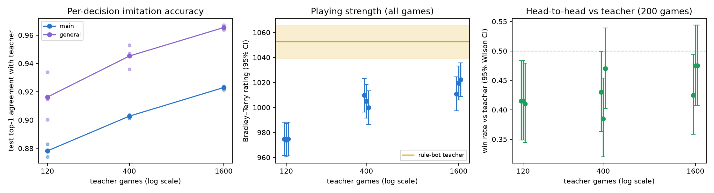

# A/01: GBDT imitation vs. amount of teacher data

**Question:** data/imitation (owner A). Does imitation quality scale with teacher data?
**Hypothesis (written 2026-11-17, before the 400/1,600 results):** per-decision top-1 agreement and the head-to-head win rate vs. the rule-bot teacher both rise from 120 → 400 → 1,600 games. Our earlier local result (120 games: 41% vs. the teacher) is data-limited.
**Baseline:** the rule-bot teacher (`lucario_rule`), and the 120-game GBDT.
**Change:** only the number of teacher games, using nested subsets balanced across opponents and seats (`ptcg_exp.subsets`, first k games per opponent×seat dir).
**Fixed:** features (`SCHEMA_ID`), `standard` profile, 16 threads, val/test = 25% / 10% of **games**.
**Seeds:** 0, 1, 2 → `derive(seed, "gbdt", "split"|"train")` (recorded in `run.json`).
**Metric:** BT rating ± CI and win rate vs. the teacher with a Wilson CI (docs/evaluation.md, `rating_v1`). Secondary: test top-1 per bank, peak RAM.
**Compute:** Eden `student` partition, 16 CPUs per task. Jobs `1943714` (120), `1943715` (400), `1943716` (1,600).
**Run script:** `jobs/gbdt_scale.sbatch` (equivalent config: `configs/exp/A/01_gbdt_data_scale.yaml`).

## Results

### Per-decision agreement (query top-1, held-out games)
| Games | Seed | main val | main test | general val | general test | train peak RAM | train wall |
|---|---|---|---|---|---|---|---|
| 120 | 0 | 0.901 | 0.883 | 0.916 | 0.934 | 11 GB | 0:42 |
| 120 | 1 | 0.898 | 0.878 | 0.924 | 0.900 | 11 GB | 0:42 |
| 120 | 2 | 0.882 | 0.874 | 0.911 | 0.915 | 11 GB | 1:08 |
| 400 | 0 | 0.907 | 0.901 | 0.953 | 0.953 | 37 GB | 1:51 |
| 400 | 1 | 0.907 | 0.904 | 0.952 | 0.936 | 37 GB | 1:21 |
| 400 | 2 | 0.909 | 0.904 | 0.947 | 0.947 | 37 GB | 1:17 |
| 1600 | 0 | 0.924 | 0.921 | 0.967 | 0.967 | 148 GB | 5:01 |
| 1600 | 1 | 0.921 | 0.924 | 0.967 | 0.964 | 149 GB | 5:31 |
| 1600 | 2 | 0.920 | 0.924 | 0.965 | 0.965 | 149 GB | 4:05 |

**Mean test top-1:** main 0.878 → 0.903 → 0.923; general 0.916 → 0.945 → 0.965 (120 → 400 → 1,600 games). The seed spread at each size (≤ 0.03) is far smaller than the gaps between sizes.
**Memory:** peak RAM ≈ 0.09 GB per game (LightGBM, 16 threads), roughly linear. It explains why 256+ games ran out of memory on the 8 GB Mac. (On the Mac, 120 games peaked lower with fewer threads; part of the peak is per-thread LightGBM buffers.)

### Playing strength (protocol `rating_v1`: 13 agents, 200 games per pair, both seats; job 1943727, 26 min on 40 CPUs)

| Games | BT rating per seed (±1.96σ ≈ 13.5) | Mean rating | Win rate vs. teacher per seed (Wilson 95% CI) |
|---|---|---|---|
| 120 | 974.8 / 973.9 / 974.7 | **974.5** | 0.415 [0.35, 0.48] / 0.415 [0.35, 0.48] / 0.410 [0.34, 0.48] |
| 400 | 1009.8 / 1004.9 / 999.9 | **1004.9** | 0.430 [0.36, 0.50] / 0.385 [0.32, 0.45] / 0.470 [0.40, 0.54] |
| 1600 | 1010.9 / 1019.5 / 1022.2 | **1017.5** | 0.425 [0.36, 0.49] / 0.475 [0.41, 0.54] / 0.475 [0.41, 0.54] |
| Teacher (rule bot) | 1052.6 ± 13.3 | | |

The rest of the pool: dragapult_rule 1045.8, abomasnow_rule 1010.2, iono_rule 900.7. Full table: `reports/A/01_gbdt_data_scale/eval_summary.json`.

**Gates:**
- Feature parity, Python ≡ C++ (exact): passed in every extraction.
- **GBDT audit:** C++ ≡ LightGBM on GBDT-played games, one per size. Feature and prediction max error 0.0, 0 action mismatches (489 / 484 / 533 decisions).
- Evaluation: 0 agent or engine errors over 15,600 games.

## Conclusion
- **Supported:** more teacher data gives stronger imitation, both per decision and in games.
  - The mean rating rises 974.5 → 1004.9 → 1017.5 (+43 overall). The 95% intervals (±13.5) of 120 vs. 1,600 don't overlap. Seeds agree within each size.
  - The earlier Mac result is reproduced: 120 games gives ~41% vs. the teacher.
- **Diminishing returns:** 3.3× more data (120 → 400) gives +30 rating points; another 4× (400 → 1,600) gives only +13.
- **The imitation gap remains:** even at 1,600 games, the GBDT is about 35 points below its teacher (a significant gap: the intervals don't overlap). Head-to-head it wins 42–48%; for two seeds the CI includes 50%.
  - This happens despite 92% / 97% per-decision agreement. Small per-decision errors compound over 100+ decisions and lead into states the teacher never visited (covariate shift).
  - This motivates **A2 (DAgger)**: label the states the imitator itself visits.

**Limitations:**
- One feature set and one deck.
- The head-to-head uses 200 games per pair (CI ±7 pp). The BT rating pools all ~2,400 games per agent and is the primary metric.
- Data sizes are nested subsets of one 1,600-game corpus.

**Decision:** the distillation teacher for A/02 is the 1,600-game GBDT, seed 0. It was chosen by test top-1 before this rating finished. Its rating (1010.9) is the lowest of the three 1,600-game seeds, but all three are within each other's CIs. Seed 2 (1022.2) is the strongest candidate if A/02 is re-run.

**Artifacts:** models on Eden under `outputs/mega_lucario/scale/runs/games_<size>_s<seed>/model/model.gbdt`. Each `run.json` records the seeds, git SHA and subset hash.
