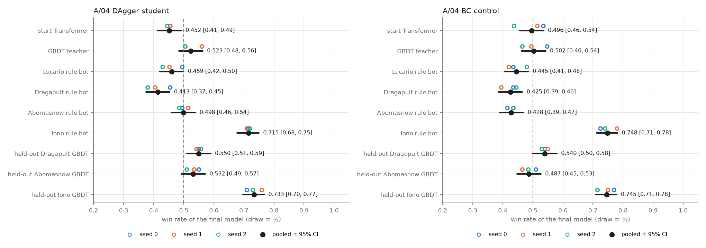

# A/03–A/05: DAgger round 1 vs. an equal-budget imitation control (3 seeds)

**Question:** dagger (owner A). Does labeling the student's own states close the Transformer → GBDT gap?
**Design:**
- **Student arm (A/04 student):** the A/02 Transformer plays 2,500 games vs. the 4 rule bots; the GBDT relabels every decision.
- **Control arm (A/04 teacher):** the GBDT plays the same 2,500 seeded games (equal label budget).
- Both are merged with A/02's features and retrained from scratch with the same seeds.
- **A/05:** both arms, the A/02 start and the GBDT are rated in one roster per seed.
- Jobs: pipecheck 1944843, student 1944844 (15 min), control 1944845 (21 min), eval 1944846. The relabel self-test (relabel ≡ extract bit for bit on GBDT games) passed first.

| | Seed 0 | Seed 1 | Seed 2 | Pooled (600 games) |
|---|---|---|---|---|
| Student ↔ teacher agreement on student states (validation) | 0.942 | 0.945 | 0.939 | ≈ 0.942 (vs. 0.955 on teacher states) |
| BT: DAgger / control / A/02 / GBDT | 1030 / 1026 / 1016 / 1035 | 1032 / 1020 / 1019 / 1035 | 1017 / 1018 / 1021 / 1040 | |
| DAgger vs. control | 0.520 | 0.525 | 0.470 | **0.505 [0.47, 0.55]** |
| DAgger vs. A/02 start | 0.455 | 0.455 | 0.445 | **0.452 [0.41, 0.49]** |
| DAgger vs. GBDT | 0.505 | 0.560 | 0.505 | 0.523 [0.48, 0.56] |
| A/02 vs. GBDT | | | | 0.490 [0.45, 0.53] |

**Result: no DAgger gain.**
- DAgger ties the equal-budget control, and loses head-to-head to its own start (BT is slightly higher, so the strength differences are non-transitive and small).
- The covariate shift is small: the student agrees with the teacher on 94.2% of its own states vs. 95.5% on the teacher's. There's little for DAgger to correct.
- **Decision:** no DAgger round 2. The student is already about as strong as the GBDT teacher, and PPO (C/01) moves strength much more (+0.125 win rate vs. start). Sprint 3 compute goes to PPO.

## Figures
Generated by `ptcg_exp.figures` from `reports/results` (see `reports/README.md`).

