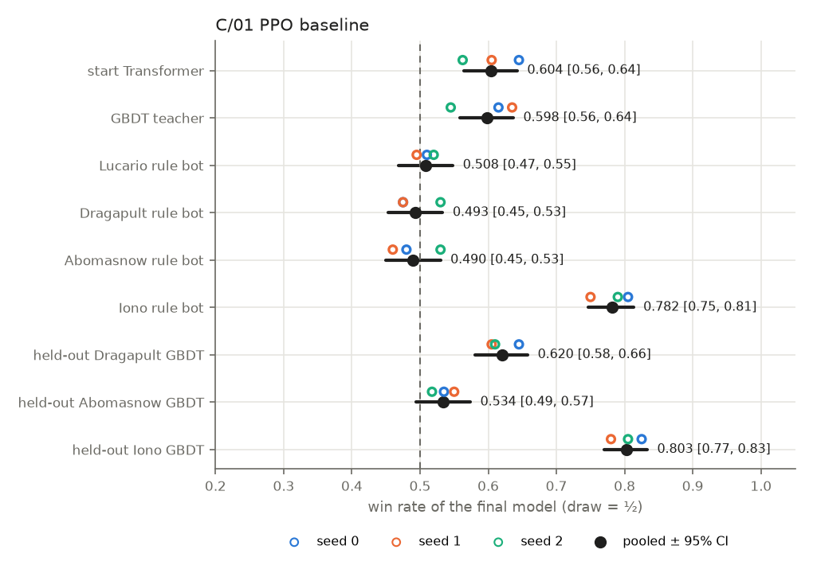
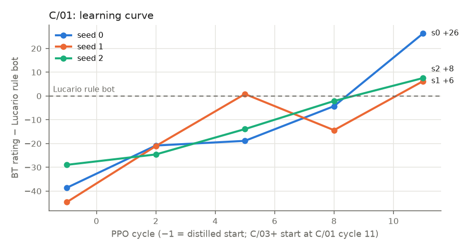
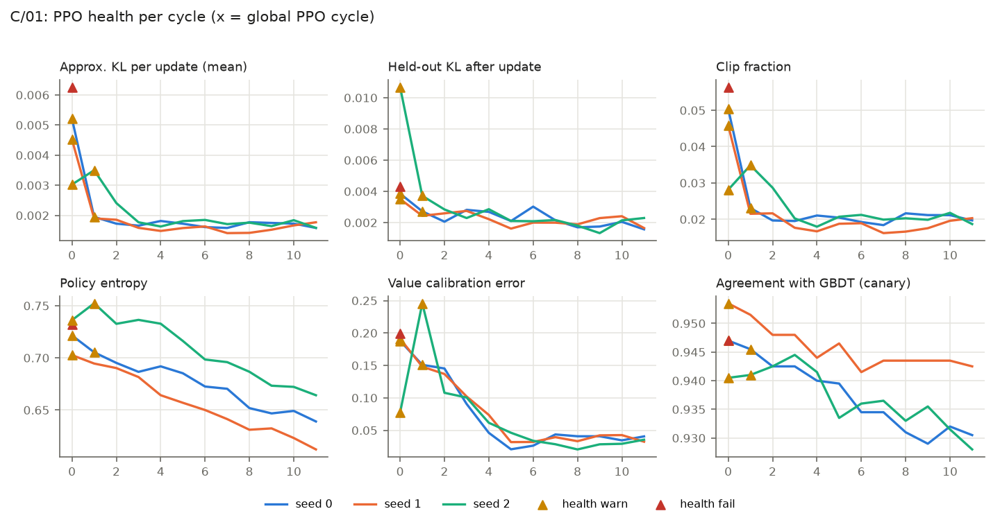

# C/01: PPO baseline at full cycle size (12 cycles × 5,000 games), 3 seeds

**Question:** ppo_ablation (owner C). Does repo-default PPO improve the distilled Transformer?
**Hypothesis (pre-registered):** after 12 cycles, PPO beats its start (pooled Wilson LCB > 0.5) with no failed health check, and ratings rise across cycles.
**Config:** `configs/exp/C/01_ppo_baseline.yaml`. Start: each A/02 seed's Transformer. Opponents: 4 rule bots + GBDT + self, equal weights. 128 updates per cycle, KL early stop off (the repo default).
**Jobs:** 1944835 (array 0–2, throttled to 1 at a time for disk). Seeds 0 and 1 took 6.2 h and 6.0 h on one RTX 6000.

## Result: hypothesis confirmed on seeds 0 and 1; seed 2 was stopped by its health gate
| | Seed 0 | Seed 1 | Pooled (400 games) |
|---|---|---|---|
| Health, 12 cycles | 2 warn (cycles 0–1), 10 pass | 1 warn (cycle 0), 11 pass | no fail |
| BT: start → c2 → c5 → c8 → final (c11) | 1005 → 1023 → 1025 → 1039 → **1070** | 1001 → 1024 → 1046 → 1031 → **1052** | |
| **vs. its start Transformer** | 0.645 [0.58, 0.71] | 0.605 [0.54, 0.67] | **0.625 [0.58, 0.67]** ✅ |
| **vs. GBDT teacher** | 0.615 [0.55, 0.68] | 0.635 [0.57, 0.70] | **0.625 [0.58, 0.67]** |
| vs. lucario_rule (the rule bot) | 0.510 | 0.495 | 0.502 [0.45, 0.55]: tie |
| vs. dragapult / abomasnow rule | 0.475 / 0.480 | 0.475 / 0.460 | 0.475 / 0.470: tie |
| vs. iono rule | 0.805 | 0.750 | 0.777 [0.73, 0.82] |
| **Held-out** (never trained against): dragapult / iono / abomasnow GBDT | 0.645 / 0.825 / 0.535 | 0.605 / 0.780 / 0.550 | 0.625 / 0.802 / 0.542 |

**Reading:**
- **PPO works at real size.** It beats its start and the GBDT on both seeds, and it gains on the held-out pool too, so the gain is not only exploitation of the training opponents.
- **It ties the rule bots head-to-head.** Its BT lead over them (1070/1052 vs. about 1044) comes from beating iono. "Better than the rule-bot teacher" isn't supported yet.
- **The learning curve is still rising at cycle 11** (seed 0 +31 from c8 to c11; seed 1 noisier). More cycles are worth trying (Sprint 3, C/03).

## Seed 2: the health gate fired at cycle 0
- `approx_kl_per_update`: max minibatch KL 0.020 > 4 × kl_target = 0.016 (mean 0.0063). KL early stop was off, so nothing stopped the epoch.
- The run stopped before any further cycle, as designed: no unhealthy checkpoint reached the next rollout.
- **Rerun as C/01b** (`01b_ppo_baseline_s2_klstop.yaml`, seed 2 only, `kl_early_stop: 2.0`). This is a deviation from the pre-registered config (one knob, one seed), reported separately. The rule also changed: a KL spike that triggered the early stop is now a warning, while the post-update held-out KL check still fails a step that's too large.

## C/01b result (seed 2, `kl_early_stop: 2.0`; job 1948509, 6.2 h): completed, no fail
- Health: warn cycles 0–1, pass 2–11.
- BT: start 1020 → c2 1024 → c5 1035 → c8 1046 → final **1056** [1042, 1070]; lucario_rule 1049 in the same roster.
- Final vs. start 0.562 [0.49, 0.63]; vs. GBDT 0.545 [0.48, 0.61]; vs. rule bots 0.52–0.53 (tie); vs. iono 0.79.
- Held-out: dragapult 0.61, iono 0.805, abomasnow 0.517.
- Same direction as seeds 0/1 but a smaller gain; on its own the CI touches 0.5. With KL early stop the run is healthy, so all 3 seeds now count.

## Figures
Generated by `ptcg_exp.figures` from `reports/results` (see `reports/README.md`).

