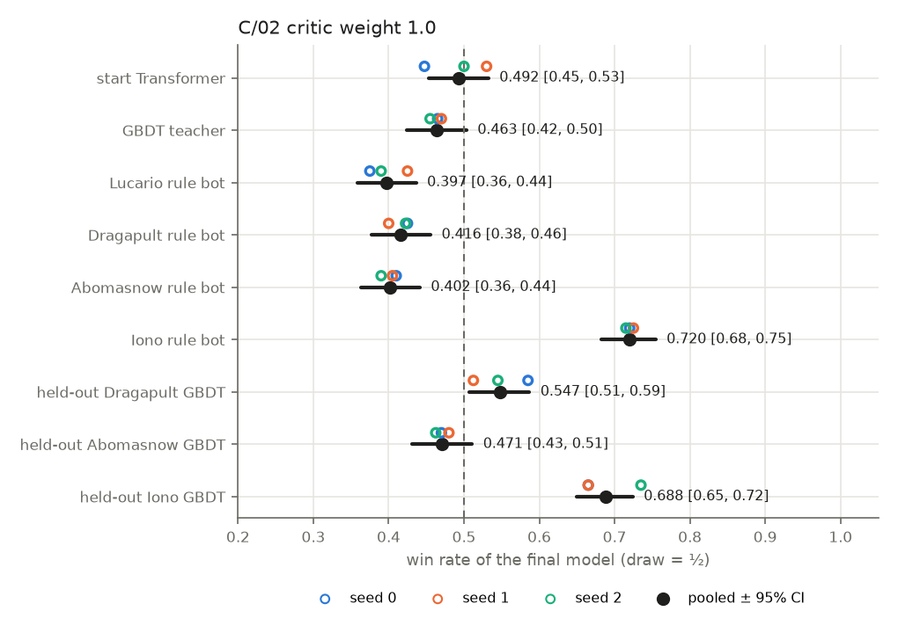

# C/02: critic ablation, value_weight 0.25 → 1.0 in distillation (3 seeds)

**Question:** does a heavier value loss in distillation give PPO a better critic, without costing the policy?
**Design:** paired with A/02. Same features (`features_from`), same training seeds; only `value_weight` changes. Jobs 1944836 (3–7 min each).

| Seed | Top-1 (A/02 → C/02) | Distill KL | Value MSE | BT (A/02 → C/02, same roster) |
|---|---|---|---|---|
| 0 | 0.955 → 0.944 | 0.024 → 0.035 | 0.662 → 0.671 | 1019 → 1004 |
| 1 | 0.952 → 0.945 | 0.026 → 0.034 | 0.699 → 0.691 | 1017 → 1007 |
| 2 | 0.957 → 0.943 | 0.022 → 0.035 | 0.753 → 0.766 | 1017 → 1008 |
| Head-to-head vs. A/02 | | | | 0.492 [0.45, 0.53] (600 games) |

**Result: rejected.**
- Value MSE doesn't improve (+0.005 mean): the value target (game outcome from a mid-game state) is noisy, and weighting it more doesn't help the critic learn it.
- The policy pays: top-1 −1.1 pp, KL +45%, and BT −11 on every seed. The head-to-head (0.49) is within noise.
- **Decision:** keep value_weight 0.25. Critic quality is better addressed inside PPO (its value loss and explained variance are monitored per cycle).

## Figures
Generated by `ptcg_exp.figures` from `reports/results` (see `reports/README.md`).

