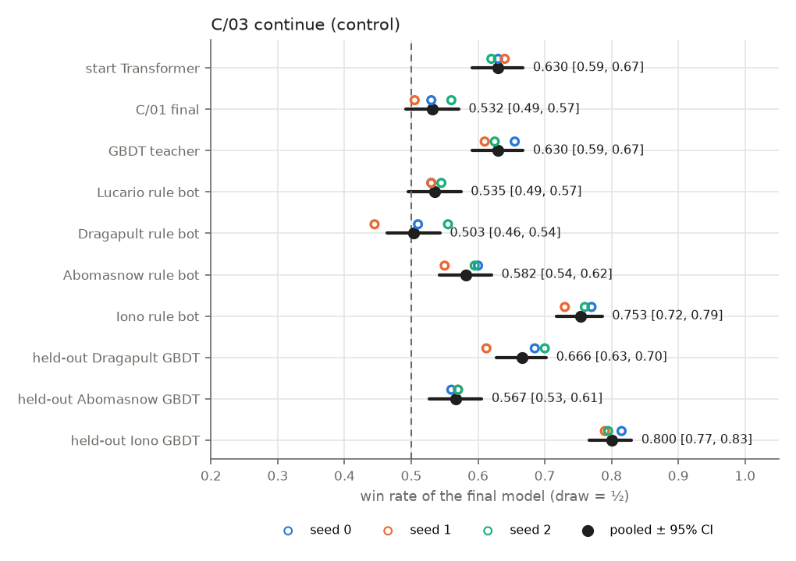
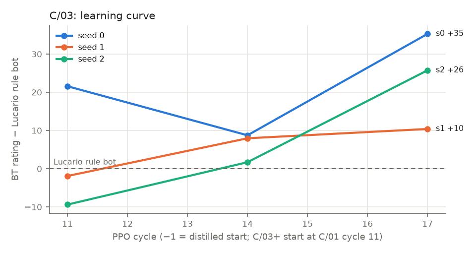
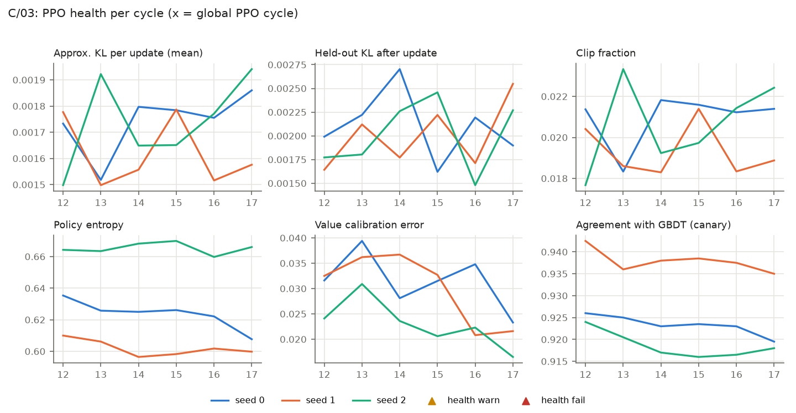

# C/03: continue C/01 for 6 more cycles, default pool (control for C/04/C/05)

**Question:** ppo_ablation (owner C). Does more PPO with the default pool keep improving? This is the paired control for the league (C/04) and PFSP (C/05) arms.
**Config:** `configs/exp/C/03_ppo_continue.yaml` (hash `4cbddd27`). Start: each C/01 seed's cycle-011 model. 6 cycles × 5,000 games × 128 updates, `kl_early_stop: 2.0`. Opponents: 4 rule bots + GBDT + self, equal weights.
**Jobs:** 1948510 (array 0–2, throttle 1), 3.1–3.4 h per seed.

## Result
Health: 18/18 cycles pass (no warn).

| | s0 | s1 | s2 | Pooled (600 games, Wilson 95%) |
|---|---|---|---|---|
| BT final (c01_final in same roster) | 1081 (1067) | 1059 (1047) | 1080 (1045) | |
| vs. C/01 final | 0.530 | 0.505 | 0.560 | **0.532 [0.49, 0.57]** |
| vs. start Transformer | 0.630 | 0.640 | 0.620 | 0.630 [0.59, 0.67] |
| vs. GBDT | 0.655 | 0.610 | 0.625 | 0.630 [0.59, 0.67] |
| vs. lucario_rule | 0.530 | 0.530 | 0.545 | 0.535 [0.50, 0.58] |
| vs. dragapult_rule | 0.510 | 0.445 | 0.555 | 0.503 [0.46, 0.54] |
| vs. abomasnow_rule | 0.600 | 0.550 | 0.595 | **0.582 [0.54, 0.62]** |
| vs. iono_rule | 0.770 | 0.730 | 0.760 | 0.753 |
| held-out dragapult / iono / abomasnow GBDT | 0.685 / 0.815 / 0.560 | 0.613 / 0.790 / 0.570 | 0.700 / 0.795 / 0.570 | 0.666 / 0.800 / 0.567 |

**Reading:**
- More PPO still helps a little: +12 to +35 BT over C/01 final on every seed, but the pooled head-to-head LCB (0.49) is just under 0.5, so by the pre-registered rule this alone isn't a promotion.
- First clear win over a non-iono rule bot (abomasnow 0.58 [0.54, 0.62]); Lucario rule bot now 0.535, LCB at 0.495. Dragapult still a tie.
- Held-out pool improves too (dragapult GBDT 0.625 → 0.666), so not just exploitation.
- This is the baseline C/04 and C/05 must beat (paired by seed).

## Figures
Generated by `ptcg_exp.figures` from `reports/results` (see `reports/README.md`).

