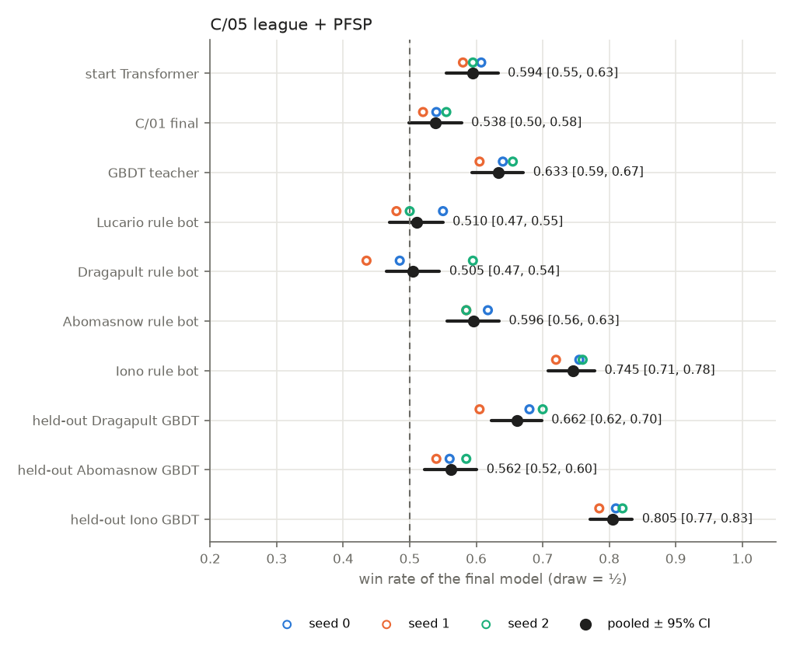
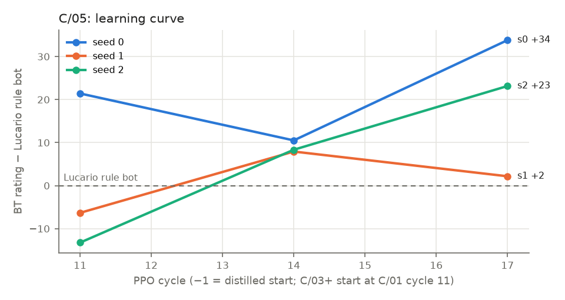
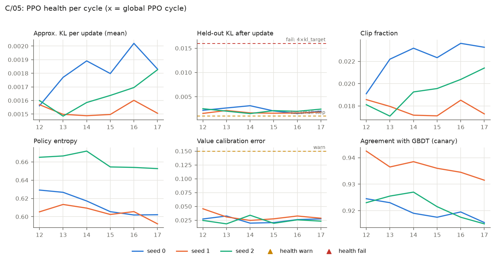

# C/05: snapshot league + PFSP (P3), paired against C/03 and C/04

**Question:** ppo_ablation (owner C). On top of the snapshot league (C/04), does weighting opponents by how often we lose to them (PFSP) help at an equal game budget?
**Config:** `configs/exp/C/05_ppo_league_pfsp.yaml` (hash `073d3c90`): C/04 + `pfsp: true`. Opponent weight = base weight × max(0.2, 1 − previous-cycle win rate); unseen opponents count as 0.5. Same start, seeds, 6 cycles × 5,000 games × 128 updates and `kl_early_stop: 2.0` as C/03/C/04.
**Jobs:** 1948512 (array 0–2, throttle 1), 2.8 h per seed.

## Result: 18/18 cycles pass
PFSP did what it was built to do. In seed 0's last cycle the Iono rule bot, which the policy beats about 76% of the time, got the lowest weight (0.27). Opponents the policy struggles against (Dragapult rule bot, its own snapshots, `self`) got about 0.5.

Results from C/05's own evaluation (pooled over 3 seeds; see the deal-set caveat in C/06):

| vs. | C/05 | C/04 | C/03 |
|---|---|---|---|
| C/01 final | 0.538 [0.50, 0.58] | 0.547 | 0.532 |
| start Transformer | 0.594 | 0.613 | 0.630 |
| Lucario rule bot | 0.510 | 0.536 | 0.535 |
| Dragapult rule bot | 0.505 | 0.512 | 0.503 |
| Abomasnow rule bot | 0.596 | 0.593 | 0.582 |
| held-out Dragapult / Abomasnow / Iono GBDT | 0.662 / 0.562 / 0.805 | 0.663 / 0.563 / 0.803 | 0.666 / 0.567 / 0.800 |

**Reading:** no measurable difference from C/03 or C/04. The direct comparison is in C/06.

## Figures
Generated by `ptcg_exp.figures` from `reports/results` (see `reports/README.md`).

