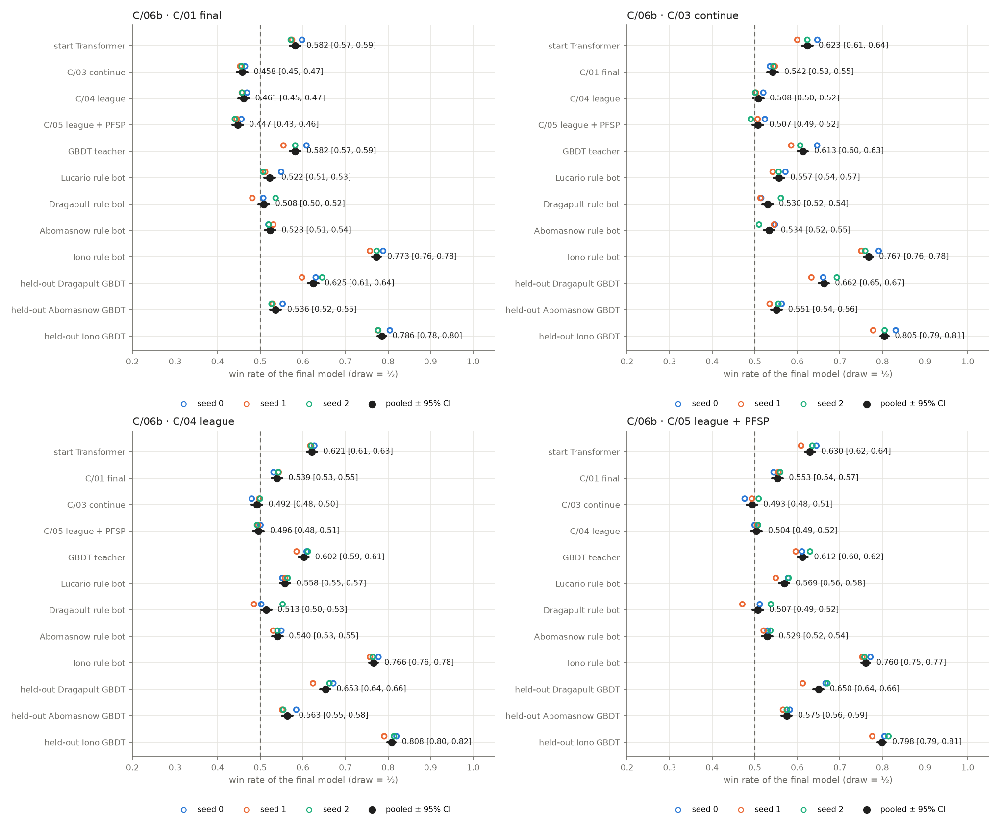
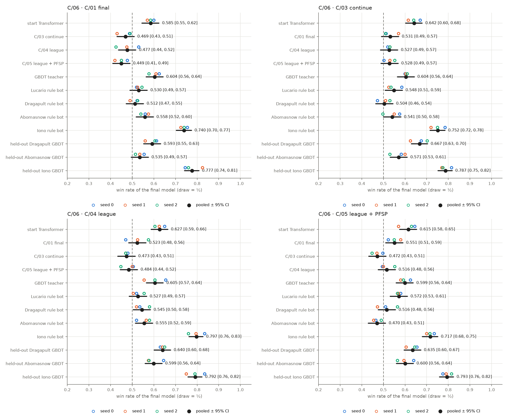

# C/06: joint evaluation of the Sprint 3 arms, and the promotion decision

**Question:** which opponent-pool variant to promote: C/03 (continue, default pool), C/04 (snapshot league) or C/05 (league + PFSP)? All three start from C/01's final model with the same seeds and budget (6 cycles × 5,000 games).
**Roster per seed:** C/01 final, C/03, C/04, C/05, the A/02 distilled start, the GBDT teacher, 4 rule bots, 3 held-out GBDTs (13 agents).
**Pre-registered rule (`docs/plan.md`):** promote an arm whose pooled head-to-head lower bound vs. C/01 final is > 0.5 and that doesn't lose on the held-out pool.

| Run | Config | Games per pair | Jobs |
|---|---|---|---|
| C/06 | `06_sprint3_eval.yaml` (`08b58908`) | 200 (100 deals × 2 seats) | 1948513, ~1 min per seed |
| **C/06b** | `06b_sprint3_eval_2k.yaml` (`3b8e886f`) | **2,000** (1,000 deals × 2 seats) | 1984220, ~10 min per seed |

## Finding about the protocol: deal sets dominated the 200-game results
The game deals for a pair are determined by the evaluation seed (fixed per protocol) and the pair's position in the sorted roster. Two consequences:
1. **All three training seeds play the identical 100 deals** against an opponent, so "600 pooled games" average over seeds, not deals. Wilson intervals computed on 600 games understate the deal-sampling uncertainty.
2. Different arms face **different deals** against the same opponent, so comparisons through a common opponent are not truly paired.

Evidence: the *same* C/05 seed-0 model scored 0.596 vs. the Abomasnow rule bot in C/05's own evaluation and 0.470 in C/06. All three seeds shifted together, which is what a shared deal set produces. Arm differences of 2–5 pp at 200 games are inside this noise. C/06b reruns the same roster with 10× the deals. **Use C/06b for decisions**. Fix for later: give every opponent a fixed, roster-independent deal set (so all arms face identical deals) and compute intervals over deals.

## Result (C/06b, 3 seeds × 2,000 games per pair)
Intervals are Wilson on 6,000 games. Because the seeds share the 1,000 deals, a conservative interval uses n = 2,000 (about ±0.022).

| Final model | vs. C/01 final | vs. C/03 | vs. C/04 | vs. C/05 | vs. Lucario rule bot | vs. Dragapult rule | vs. Abomasnow rule | held-out pooled |
|---|---|---|---|---|---|---|---|---|
| C/03 continue | **0.542** [0.53, 0.56] | — | 0.508 | 0.507 | **0.557** [0.54, 0.57] | 0.530 | 0.534 | 0.673 |
| C/04 league | **0.539** [0.53, 0.55] | 0.492 | — | 0.496 | **0.558** [0.55, 0.57] | 0.513 | 0.540 | 0.675 |
| C/05 league + PFSP | **0.553** [0.54, 0.57] | 0.493 | 0.504 | — | **0.569** [0.56, 0.58] | 0.507 | 0.529 | 0.674 |
| C/01 final | — | 0.458 | 0.461 | 0.447 | 0.522 | 0.508 | 0.523 | 0.649 |

## Conclusions
1. **Six more PPO cycles help, whichever pool:** every arm beats C/01 final by 4–5 pp (lower bound ≥ 0.52 even with the conservative n). They also gain on the held-out pool (0.649 → 0.673–0.675), so this is not exploitation of the training opponents.
2. **The opponent pool made no measurable difference at this budget:** arm vs. arm is 0.49–0.51 everywhere. The snapshot league and PFSP neither help nor hurt over 6 cycles. Hypotheses P2/P3 are **not supported**. A pool effect may need many more cycles (the 24th place ran hundreds) or a broader pool (other-deck learned agents).
3. **First clear win over the rule-bot teacher:** all three arms beat the Lucario rule bot at 0.56–0.57 with the lower bound above 0.54 (C/01 final: 0.522). Dragapult and Abomasnow rule bots are small wins (0.51–0.54).
4. **Promotion:** all three arms pass the pre-registered rule. **C/05 is promoted as champion** on the tie-break of the highest point estimates vs. C/01 final (0.553) and the Lucario rule bot (0.569), knowing that it is statistically tied with C/03 and C/04. Submitted model: **C/05 seed 0, cycle 5** (the seed gated first; its seeds are within noise of each other, and picking the best-looking seed would be selection on noise).

## Kaggle gate for the champion (job 1984213)
`submissions/c05_s0_final.tar.gz` (on Eden; 5.8 MB): NumPy scores ≡ C++ within 3.2e-6 on 473 queries, 471/471 actions identical, card table equal (1,431 cards), 27–13 vs. the 4 rule bots in Kaggle's own simulator (cg), decision time p50 6 ms / p99 11 ms. **Passed.** Upload is the user's step.

## Figures

